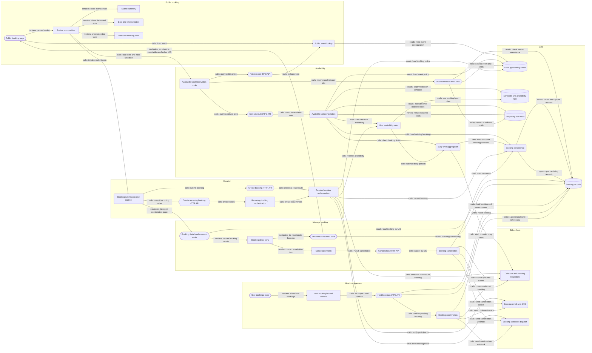

# LLM-only booking graph

36 nodes, 62 edges; source commit `54343aa685ae8f33159d2f485ec4a57bad5c574a`.

Generated from graph.json. All source links are pinned. This is a scoped, unevaluated prediction, not a reference graph.

## Components

### Public booking page (`public-page`; page)

The /[user]/[type] route loads public event data and existing booking context, then renders the booking view. This node includes its route adapter and server-side loader.

Files and evidence: [apps/web/app/(booking-page-wrapper)/[user]/[type]/page.tsx:15-33](https://github.com/calcom/cal.diy/blob/54343aa685ae8f33159d2f485ec4a57bad5c574a/apps/web/app/%28booking-page-wrapper%29/%5Buser%5D/%5Btype%5D/page.tsx#L15-L33); [apps/web/modules/users/views/users-type-public-view.tsx:27-40](https://github.com/calcom/cal.diy/blob/54343aa685ae8f33159d2f485ec4a57bad5c574a/apps/web/modules/users/views/users-type-public-view.tsx#L27-L40); [apps/web/server/lib/[user]/[type]/getServerSideProps.ts:149-160](https://github.com/calcom/cal.diy/blob/54343aa685ae8f33159d2f485ec4a57bad5c574a/apps/web/server/lib/%5Buser%5D/%5Btype%5D/getServerSideProps.ts#L149-L160).

### Public event lookup (`public-event`; service)

Resolves a public event by username and slug and shapes event configuration for the booker; reused by SSR and the public tRPC query.

Files and evidence: [packages/features/eventtypes/repositories/EventRepository.ts:12-24](https://github.com/calcom/cal.diy/blob/54343aa685ae8f33159d2f485ec4a57bad5c574a/packages/features/eventtypes/repositories/EventRepository.ts#L12-L24); [packages/features/eventtypes/lib/getPublicEvent.ts:437-444](https://github.com/calcom/cal.diy/blob/54343aa685ae8f33159d2f485ec4a57bad5c574a/packages/features/eventtypes/lib/getPublicEvent.ts#L437-L444).

### Booker composition (`booker`; ui_component)

Coordinates event data, availability, reservation and booking hooks and renders event details, date/time selection and the attendee form.

Files and evidence: [apps/web/modules/bookings/components/BookerWebWrapper.tsx:131-159](https://github.com/calcom/cal.diy/blob/54343aa685ae8f33159d2f485ec4a57bad5c574a/apps/web/modules/bookings/components/BookerWebWrapper.tsx#L131-L159); [apps/web/modules/bookings/components/Booker.tsx:248-258](https://github.com/calcom/cal.diy/blob/54343aa685ae8f33159d2f485ec4a57bad5c574a/apps/web/modules/bookings/components/Booker.tsx#L248-L258).

### Event summary (`event-summary`; ui_component)

Displays event metadata such as title, duration, organizer, location and price within the booker.

Files and evidence: [apps/web/modules/bookings/components/EventMeta.tsx:46-61](https://github.com/calcom/cal.diy/blob/54343aa685ae8f33159d2f485ec4a57bad5c574a/apps/web/modules/bookings/components/EventMeta.tsx#L46-L61).

### Date and time selection (`date-slots`; ui_component)

Presents dates and available time slots and handles selecting or submitting a slot.

Files and evidence: [apps/web/modules/bookings/components/DatePicker.tsx:55-68](https://github.com/calcom/cal.diy/blob/54343aa685ae8f33159d2f485ec4a57bad5c574a/apps/web/modules/bookings/components/DatePicker.tsx#L55-L68); [apps/web/modules/bookings/components/AvailableTimeSlots.tsx:149-164](https://github.com/calcom/cal.diy/blob/54343aa685ae8f33159d2f485ec4a57bad5c574a/apps/web/modules/bookings/components/AvailableTimeSlots.tsx#L149-L164).

### Attendee booking form (`booking-form`; ui_component)

Renders booking fields and submits through callbacks supplied by the Booker composition.

Files and evidence: [apps/web/modules/bookings/components/BookEventForm/BookEventForm.tsx:46-63](https://github.com/calcom/cal.diy/blob/54343aa685ae8f33159d2f485ec4a57bad5c574a/apps/web/modules/bookings/components/BookEventForm/BookEventForm.tsx#L46-L63); [apps/web/modules/bookings/components/BookEventForm/BookEventForm.tsx:120-135](https://github.com/calcom/cal.diy/blob/54343aa685ae8f33159d2f485ec4a57bad5c574a/apps/web/modules/bookings/components/BookEventForm/BookEventForm.tsx#L120-L135).

### Availability and reservation hooks (`availability-client`; service)

Loads public events, queries time slots and reserves/releases selected slots. The conditional team API v2 branch is outside the modeled server boundary.

Files and evidence: [apps/web/modules/schedules/hooks/useEvent.ts:21-39](https://github.com/calcom/cal.diy/blob/54343aa685ae8f33159d2f485ec4a57bad5c574a/apps/web/modules/schedules/hooks/useEvent.ts#L21-L39); [apps/web/modules/schedules/hooks/useSchedule.ts:138-154](https://github.com/calcom/cal.diy/blob/54343aa685ae8f33159d2f485ec4a57bad5c574a/apps/web/modules/schedules/hooks/useSchedule.ts#L138-L154); [apps/web/modules/bookings/hooks/useSlots.ts:90-108](https://github.com/calcom/cal.diy/blob/54343aa685ae8f33159d2f485ec4a57bad5c574a/apps/web/modules/bookings/hooks/useSlots.ts#L90-L108).

### Public event tRPC API (`public-event-api`; api_endpoint)

Public viewer.event procedure, exposed through the public tRPC route, delegates to public event lookup.

Files and evidence: [apps/web/pages/api/trpc/public/[trpc].ts:1-4](https://github.com/calcom/cal.diy/blob/54343aa685ae8f33159d2f485ec4a57bad5c574a/apps/web/pages/api/trpc/public/%5Btrpc%5D.ts#L1-L4); [packages/trpc/server/routers/publicViewer/_router.tsx:22-22](https://github.com/calcom/cal.diy/blob/54343aa685ae8f33159d2f485ec4a57bad5c574a/packages/trpc/server/routers/publicViewer/_router.tsx#L22-L22); [packages/trpc/server/routers/publicViewer/procedures/event.ts:5-10](https://github.com/calcom/cal.diy/blob/54343aa685ae8f33159d2f485ec4a57bad5c574a/packages/trpc/server/routers/publicViewer/procedures/event.ts#L5-L10); [packages/trpc/server/routers/publicViewer/event.handler.ts:10-14](https://github.com/calcom/cal.diy/blob/54343aa685ae8f33159d2f485ec4a57bad5c574a/packages/trpc/server/routers/publicViewer/event.handler.ts#L10-L14).

### Slot schedule tRPC API (`slots-api`; api_endpoint)

viewer.slots.getSchedule validates public query input and delegates to AvailableSlotsService.

Files and evidence: [apps/web/pages/api/trpc/slots/[trpc].ts:1-4](https://github.com/calcom/cal.diy/blob/54343aa685ae8f33159d2f485ec4a57bad5c574a/apps/web/pages/api/trpc/slots/%5Btrpc%5D.ts#L1-L4); [packages/trpc/server/routers/viewer/slots/_router.tsx:16-25](https://github.com/calcom/cal.diy/blob/54343aa685ae8f33159d2f485ec4a57bad5c574a/packages/trpc/server/routers/viewer/slots/_router.tsx#L16-L25); [packages/trpc/server/routers/viewer/slots/getSchedule.handler.ts:1-8](https://github.com/calcom/cal.diy/blob/54343aa685ae8f33159d2f485ec4a57bad5c574a/packages/trpc/server/routers/viewer/slots/getSchedule.handler.ts#L1-L8).

### Slot reservation tRPC API (`reservations-api`; api_endpoint)

viewer.slots.reserveSlot and removeSelectedSlotMark manage expiring slot holds using a booker UID. Seated-event behavior is conditional.

Files and evidence: [packages/trpc/server/routers/viewer/slots/_router.tsx:26-33](https://github.com/calcom/cal.diy/blob/54343aa685ae8f33159d2f485ec4a57bad5c574a/packages/trpc/server/routers/viewer/slots/_router.tsx#L26-L33); [packages/trpc/server/routers/viewer/slots/_router.tsx:45-55](https://github.com/calcom/cal.diy/blob/54343aa685ae8f33159d2f485ec4a57bad5c574a/packages/trpc/server/routers/viewer/slots/_router.tsx#L45-L55); [packages/trpc/server/routers/viewer/slots/reserveSlot.handler.ts:77-101](https://github.com/calcom/cal.diy/blob/54343aa685ae8f33159d2f485ec4a57bad5c574a/packages/trpc/server/routers/viewer/slots/reserveSlot.handler.ts#L77-L101).

### Available slot computation (`slot-engine`; service)

Combines event configuration, existing bookings, host availability, schedule restrictions and temporary holds into bookable slots. Repository helpers are grouped with this service.

Files and evidence: [packages/trpc/server/routers/viewer/slots/util.ts:807-829](https://github.com/calcom/cal.diy/blob/54343aa685ae8f33159d2f485ec4a57bad5c574a/packages/trpc/server/routers/viewer/slots/util.ts#L807-L829); [packages/features/schedules/lib/slots.ts:232-246](https://github.com/calcom/cal.diy/blob/54343aa685ae8f33159d2f485ec4a57bad5c574a/packages/features/schedules/lib/slots.ts#L232-L246); [packages/features/schedules/repositories/ScheduleRepository.ts:22-35](https://github.com/calcom/cal.diy/blob/54343aa685ae8f33159d2f485ec4a57bad5c574a/packages/features/schedules/repositories/ScheduleRepository.ts#L22-L35); [packages/features/selectedSlots/repositories/PrismaSelectedSlotRepository.ts:61-75](https://github.com/calcom/cal.diy/blob/54343aa685ae8f33159d2f485ec4a57bad5c574a/packages/features/selectedSlots/repositories/PrismaSelectedSlotRepository.ts#L61-L75); [packages/features/eventtypes/repositories/eventTypeRepository.ts:1243-1253](https://github.com/calcom/cal.diy/blob/54343aa685ae8f33159d2f485ec4a57bad5c574a/packages/features/eventtypes/repositories/eventTypeRepository.ts#L1243-L1253).

### User availability rules (`user-availability`; service)

Builds availability from schedules, date overrides, timezones, buffers and busy periods; used both when showing slots and validating a booking.

Files and evidence: [packages/features/availability/lib/getUserAvailability.ts:395-419](https://github.com/calcom/cal.diy/blob/54343aa685ae8f33159d2f485ec4a57bad5c574a/packages/features/availability/lib/getUserAvailability.ts#L395-L419); [packages/features/availability/lib/getUserAvailability.ts:584-603](https://github.com/calcom/cal.diy/blob/54343aa685ae8f33159d2f485ec4a57bad5c574a/packages/features/availability/lib/getUserAvailability.ts#L584-L603).

### Busy-time aggregation (`busy-times`; service)

Combines existing bookings and connected-calendar busy periods, including inputs for booking-limit checks.

Files and evidence: [packages/features/busyTimes/services/getBusyTimes.ts:121-134](https://github.com/calcom/cal.diy/blob/54343aa685ae8f33159d2f485ec4a57bad5c574a/packages/features/busyTimes/services/getBusyTimes.ts#L121-L134); [packages/features/busyTimes/services/getBusyTimes.ts:193-204](https://github.com/calcom/cal.diy/blob/54343aa685ae8f33159d2f485ec4a57bad5c574a/packages/features/busyTimes/services/getBusyTimes.ts#L193-L204).

### Calendar and meeting integrations (`calendar-integrations`; service)

CalendarManager reads provider busy times and creates, updates or deletes calendar events; EventManager coordinates booking creation, rescheduling and cancellation with integrations. Provider internals are not expanded.

Files and evidence: [packages/features/bookings/lib/EventManager.ts:287-303](https://github.com/calcom/cal.diy/blob/54343aa685ae8f33159d2f485ec4a57bad5c574a/packages/features/bookings/lib/EventManager.ts#L287-L303); [packages/features/bookings/lib/EventManager.ts:777-791](https://github.com/calcom/cal.diy/blob/54343aa685ae8f33159d2f485ec4a57bad5c574a/packages/features/bookings/lib/EventManager.ts#L777-L791); [packages/features/calendars/lib/CalendarManager.ts:296-310](https://github.com/calcom/cal.diy/blob/54343aa685ae8f33159d2f485ec4a57bad5c574a/packages/features/calendars/lib/CalendarManager.ts#L296-L310); [packages/features/calendars/lib/CalendarManager.ts:360-370](https://github.com/calcom/cal.diy/blob/54343aa685ae8f33159d2f485ec4a57bad5c574a/packages/features/calendars/lib/CalendarManager.ts#L360-L370).

### Booking submission and redirect (`booking-client`; service)

Client mutations submit ordinary or recurring bookings and navigate to the normal booking detail page. Payment, dry-run, custom redirect and decoy paths are separate conditional outcomes outside this graph.

Files and evidence: [apps/web/modules/bookings/hooks/useBookings.ts:136-138](https://github.com/calcom/cal.diy/blob/54343aa685ae8f33159d2f485ec4a57bad5c574a/apps/web/modules/bookings/hooks/useBookings.ts#L136-L138); [packages/features/bookings/lib/create-booking.ts:5-15](https://github.com/calcom/cal.diy/blob/54343aa685ae8f33159d2f485ec4a57bad5c574a/packages/features/bookings/lib/create-booking.ts#L5-L15); [packages/features/bookings/lib/create-recurring-booking.ts:5-15](https://github.com/calcom/cal.diy/blob/54343aa685ae8f33159d2f485ec4a57bad5c574a/packages/features/bookings/lib/create-recurring-booking.ts#L5-L15); [packages/features/bookings/lib/bookingSuccessRedirect.ts:241-249](https://github.com/calcom/cal.diy/blob/54343aa685ae8f33159d2f485ec4a57bad5c574a/packages/features/bookings/lib/bookingSuccessRedirect.ts#L241-L249).

### Create booking HTTP API (`create-api`; api_endpoint)

/api/book/event checks bot/rate limits, obtains session context and invokes RegularBookingService.

Files and evidence: [apps/web/pages/api/book/event.ts:49-63](https://github.com/calcom/cal.diy/blob/54343aa685ae8f33159d2f485ec4a57bad5c574a/apps/web/pages/api/book/event.ts#L49-L63).

### Create recurring booking HTTP API (`recurring-api`; api_endpoint)

/api/book/recurring-event supplies session and platform metadata to RecurringBookingService.

Files and evidence: [apps/web/pages/api/book/recurring-event.ts:43-59](https://github.com/calcom/cal.diy/blob/54343aa685ae8f33159d2f485ec4a57bad5c574a/apps/web/pages/api/book/recurring-event.ts#L43-L59).

### Regular booking orchestration (`regular-booking`; service)

Validates event and host availability, creates or reschedules a booking, and coordinates calendar, notification and webhook effects. Includes the directly inspected validation/event-loading helpers.

Files and evidence: [packages/features/bookings/lib/service/RegularBookingService.ts:2653-2670](https://github.com/calcom/cal.diy/blob/54343aa685ae8f33159d2f485ec4a57bad5c574a/packages/features/bookings/lib/service/RegularBookingService.ts#L2653-L2670); [packages/features/bookings/lib/handleNewBooking/ensureAvailableUsers.ts:94-105](https://github.com/calcom/cal.diy/blob/54343aa685ae8f33159d2f485ec4a57bad5c574a/packages/features/bookings/lib/handleNewBooking/ensureAvailableUsers.ts#L94-L105); [packages/features/bookings/lib/handleNewBooking/getEventType.ts:19-28](https://github.com/calcom/cal.diy/blob/54343aa685ae8f33159d2f485ec4a57bad5c574a/packages/features/bookings/lib/handleNewBooking/getEventType.ts#L19-L28); [packages/features/bookings/lib/handleNewBooking/getEventTypesFromDB.ts:204-214](https://github.com/calcom/cal.diy/blob/54343aa685ae8f33159d2f485ec4a57bad5c574a/packages/features/bookings/lib/handleNewBooking/getEventTypesFromDB.ts#L204-L214).

### Recurring booking orchestration (`recurring-booking`; service)

Builds the recurring series by invoking the regular booking service for individual occurrences with recurring metadata.

Files and evidence: [packages/features/bookings/lib/service/RecurringBookingService.ts:94-117](https://github.com/calcom/cal.diy/blob/54343aa685ae8f33159d2f485ec4a57bad5c574a/packages/features/bookings/lib/service/RecurringBookingService.ts#L94-L117).

### Booking persistence (`booking-persistence`; service)

Transactional creation also cancels the original record on reschedule; BookingRepository supplies shared booking queries and updates.

Files and evidence: [packages/features/bookings/lib/handleNewBooking/createBooking.ts:139-147](https://github.com/calcom/cal.diy/blob/54343aa685ae8f33159d2f485ec4a57bad5c574a/packages/features/bookings/lib/handleNewBooking/createBooking.ts#L139-L147); [packages/features/bookings/repositories/BookingRepository.ts:737-754](https://github.com/calcom/cal.diy/blob/54343aa685ae8f33159d2f485ec4a57bad5c574a/packages/features/bookings/repositories/BookingRepository.ts#L737-L754); [packages/features/bookings/repositories/BookingRepository.ts:1550-1564](https://github.com/calcom/cal.diy/blob/54343aa685ae8f33159d2f485ec4a57bad5c574a/packages/features/bookings/repositories/BookingRepository.ts#L1550-L1564).

### Booking email and SMS (`notifications`; service)

Dispatches requested, confirmed, rescheduled and cancelled booking notifications. Delivery providers and asynchronous task infrastructure are boundary dependencies.

Files and evidence: [packages/features/bookings/lib/BookingEmailSmsHandler.ts:94-105](https://github.com/calcom/cal.diy/blob/54343aa685ae8f33159d2f485ec4a57bad5c574a/packages/features/bookings/lib/BookingEmailSmsHandler.ts#L94-L105); [packages/emails/email-manager.ts:130-133](https://github.com/calcom/cal.diy/blob/54343aa685ae8f33159d2f485ec4a57bad5c574a/packages/emails/email-manager.ts#L130-L133); [packages/emails/email-manager.ts:501-514](https://github.com/calcom/cal.diy/blob/54343aa685ae8f33159d2f485ec4a57bad5c574a/packages/emails/email-manager.ts#L501-L514).

### Booking webhook dispatch (`webhooks`; service)

Resolves webhook subscribers and sends or schedules booking event payloads. Downstream subscribers and task execution are outside scope.

Files and evidence: [packages/features/bookings/lib/handleWebhookTrigger.ts:23-39](https://github.com/calcom/cal.diy/blob/54343aa685ae8f33159d2f485ec4a57bad5c574a/packages/features/bookings/lib/handleWebhookTrigger.ts#L23-L39); [packages/features/webhooks/lib/sendOrSchedulePayload.ts:1-12](https://github.com/calcom/cal.diy/blob/54343aa685ae8f33159d2f485ec4a57bad5c574a/packages/features/webhooks/lib/sendOrSchedulePayload.ts#L1-L12).

### Booking detail and success route (`detail-page`; page)

/booking/[uid] is the normal confirmation/detail route; its loader retrieves the booking, related event configuration and reschedule context.

Files and evidence: [apps/web/app/(booking-page-wrapper)/booking/[uid]/page.tsx:42-58](https://github.com/calcom/cal.diy/blob/54343aa685ae8f33159d2f485ec4a57bad5c574a/apps/web/app/%28booking-page-wrapper%29/booking/%5Buid%5D/page.tsx#L42-L58); [apps/web/modules/bookings/views/bookings-single-view.getServerSideProps.tsx:65-83](https://github.com/calcom/cal.diy/blob/54343aa685ae8f33159d2f485ec4a57bad5c574a/apps/web/modules/bookings/views/bookings-single-view.getServerSideProps.tsx#L65-L83); [packages/features/bookings/lib/getBookingInfo.ts:5-14](https://github.com/calcom/cal.diy/blob/54343aa685ae8f33159d2f485ec4a57bad5c574a/packages/features/bookings/lib/getBookingInfo.ts#L5-L14); [packages/features/bookings/lib/getUserBooking.ts:3-19](https://github.com/calcom/cal.diy/blob/54343aa685ae8f33159d2f485ec4a57bad5c574a/packages/features/bookings/lib/getUserBooking.ts#L3-L19).

### Booking detail view (`detail-ui`; ui_component)

Displays the booking result and status and exposes reschedule and cancellation controls according to event/booking conditions.

Files and evidence: [apps/web/modules/bookings/views/bookings-single-view.tsx:882-899](https://github.com/calcom/cal.diy/blob/54343aa685ae8f33159d2f485ec4a57bad5c574a/apps/web/modules/bookings/views/bookings-single-view.tsx#L882-L899); [apps/web/modules/bookings/views/bookings-single-view.tsx:925-939](https://github.com/calcom/cal.diy/blob/54343aa685ae8f33159d2f485ec4a57bad5c574a/apps/web/modules/bookings/views/bookings-single-view.tsx#L925-L939).

### Reschedule redirect route (`reschedule-page`; route)

/reschedule/[uid] reads the original booking, enforces restrictions and redirects to its event URL with rescheduleUid. The normal booking flow then submits the replacement.

Files and evidence: [apps/web/app/reschedule/[uid]/page.tsx:8-18](https://github.com/calcom/cal.diy/blob/54343aa685ae8f33159d2f485ec4a57bad5c574a/apps/web/app/reschedule/%5Buid%5D/page.tsx#L8-L18); [apps/web/lib/reschedule/[uid]/getServerSideProps.ts:181-207](https://github.com/calcom/cal.diy/blob/54343aa685ae8f33159d2f485ec4a57bad5c574a/apps/web/lib/reschedule/%5Buid%5D/getServerSideProps.ts#L181-L207); [packages/features/bookings/lib/buildEventUrlFromBooking.ts:38-54](https://github.com/calcom/cal.diy/blob/54343aa685ae8f33159d2f485ec4a57bad5c574a/packages/features/bookings/lib/buildEventUrlFromBooking.ts#L38-L54).

### Cancellation form (`cancel-ui`; ui_component)

Collects the cancellation reason and series/seat options, fetches a CSRF token and posts cancellation by UID.

Files and evidence: [apps/web/components/booking/CancelBooking.tsx:280-301](https://github.com/calcom/cal.diy/blob/54343aa685ae8f33159d2f485ec4a57bad5c574a/apps/web/components/booking/CancelBooking.tsx#L280-L301).

### Cancellation HTTP API (`cancel-api`; api_endpoint)

/api/cancel supports POST and DELETE, validates CSRF and UID input, applies rate limiting and calls the cancellation handler.

Files and evidence: [apps/web/app/api/cancel/route.ts:23-36](https://github.com/calcom/cal.diy/blob/54343aa685ae8f33159d2f485ec4a57bad5c574a/apps/web/app/api/cancel/route.ts#L23-L36); [apps/web/app/api/cancel/route.ts:49-71](https://github.com/calcom/cal.diy/blob/54343aa685ae8f33159d2f485ec4a57bad5c574a/apps/web/app/api/cancel/route.ts#L49-L71).

### Booking cancellation (`cancel-booking`; service)

Cancels individual, recurring or seated bookings and coordinates repository changes, integration cleanup, email/SMS and webhook effects.

Files and evidence: [packages/features/bookings/lib/handleCancelBooking.ts:81-104](https://github.com/calcom/cal.diy/blob/54343aa685ae8f33159d2f485ec4a57bad5c574a/packages/features/bookings/lib/handleCancelBooking.ts#L81-L104); [packages/features/bookings/lib/handleCancelBooking.ts:394-405](https://github.com/calcom/cal.diy/blob/54343aa685ae8f33159d2f485ec4a57bad5c574a/packages/features/bookings/lib/handleCancelBooking.ts#L394-L405).

### Host bookings route (`host-page`; page)

/bookings/[status] checks the authenticated session, validates the status and renders the host bookings view.

Files and evidence: [apps/web/app/(use-page-wrapper)/(main-nav)/bookings/[status]/page.tsx:27-37](https://github.com/calcom/cal.diy/blob/54343aa685ae8f33159d2f485ec4a57bad5c574a/apps/web/app/%28use-page-wrapper%29/%28main-nav%29/bookings/%5Bstatus%5D/page.tsx#L27-L37); [apps/web/app/(use-page-wrapper)/(main-nav)/bookings/[status]/page.tsx:58-64](https://github.com/calcom/cal.diy/blob/54343aa685ae8f33159d2f485ec4a57bad5c574a/apps/web/app/%28use-page-wrapper%29/%28main-nav%29/bookings/%5Bstatus%5D/page.tsx#L58-L64).

### Host booking list and actions (`host-ui`; ui_component)

Lists bookings, opens a detail sheet and invokes confirmation/rejection actions. The alternate calendar list presentation and other action internals are not expanded.

Files and evidence: [apps/web/modules/bookings/views/bookings-view.tsx:78-96](https://github.com/calcom/cal.diy/blob/54343aa685ae8f33159d2f485ec4a57bad5c574a/apps/web/modules/bookings/views/bookings-view.tsx#L78-L96); [apps/web/modules/bookings/components/BookingListContainer.tsx:269-279](https://github.com/calcom/cal.diy/blob/54343aa685ae8f33159d2f485ec4a57bad5c574a/apps/web/modules/bookings/components/BookingListContainer.tsx#L269-L279); [apps/web/modules/bookings/components/BookingDetailsSheet.tsx:153-164](https://github.com/calcom/cal.diy/blob/54343aa685ae8f33159d2f485ec4a57bad5c574a/apps/web/modules/bookings/components/BookingDetailsSheet.tsx#L153-L164); [apps/web/components/booking/actions/BookingActionsDropdown.tsx:78-89](https://github.com/calcom/cal.diy/blob/54343aa685ae8f33159d2f485ec4a57bad5c574a/apps/web/components/booking/actions/BookingActionsDropdown.tsx#L78-L89); [apps/web/components/booking/hooks/useBookingConfirmation.tsx:28-43](https://github.com/calcom/cal.diy/blob/54343aa685ae8f33159d2f485ec4a57bad5c574a/apps/web/components/booking/hooks/useBookingConfirmation.tsx#L28-L43).

### Host bookings tRPC API (`host-api`; api_endpoint)

Authenticated get/getBookingDetails queries and confirm mutation. Confirmation delegates to the confirmation service; rejection updates booking status in the handler. Other procedures in the same router are outside the modeled subset.

Files and evidence: [apps/web/pages/api/trpc/bookings/[trpc].ts:1-4](https://github.com/calcom/cal.diy/blob/54343aa685ae8f33159d2f485ec4a57bad5c574a/apps/web/pages/api/trpc/bookings/%5Btrpc%5D.ts#L1-L4); [packages/trpc/server/routers/viewer/bookings/_router.tsx:22-30](https://github.com/calcom/cal.diy/blob/54343aa685ae8f33159d2f485ec4a57bad5c574a/packages/trpc/server/routers/viewer/bookings/_router.tsx#L22-L30); [packages/trpc/server/routers/viewer/bookings/_router.tsx:62-69](https://github.com/calcom/cal.diy/blob/54343aa685ae8f33159d2f485ec4a57bad5c574a/packages/trpc/server/routers/viewer/bookings/_router.tsx#L62-L69); [packages/trpc/server/routers/viewer/bookings/get.handler.ts:658-671](https://github.com/calcom/cal.diy/blob/54343aa685ae8f33159d2f485ec4a57bad5c574a/packages/trpc/server/routers/viewer/bookings/get.handler.ts#L658-L671); [packages/trpc/server/routers/viewer/bookings/getBookingDetails.handler.ts:14-21](https://github.com/calcom/cal.diy/blob/54343aa685ae8f33159d2f485ec4a57bad5c574a/packages/trpc/server/routers/viewer/bookings/getBookingDetails.handler.ts#L14-L21); [packages/trpc/server/routers/viewer/bookings/confirm.handler.ts:62-76](https://github.com/calcom/cal.diy/blob/54343aa685ae8f33159d2f485ec4a57bad5c574a/packages/trpc/server/routers/viewer/bookings/confirm.handler.ts#L62-L76).

### Booking confirmation (`confirmation`; service)

Creates meeting/calendar references, marks pending bookings accepted and sends confirmation notifications and webhooks.

Files and evidence: [packages/features/bookings/lib/handleConfirmation.ts:75-80](https://github.com/calcom/cal.diy/blob/54343aa685ae8f33159d2f485ec4a57bad5c574a/packages/features/bookings/lib/handleConfirmation.ts#L75-L80); [packages/features/bookings/lib/handleConfirmation.ts:245-258](https://github.com/calcom/cal.diy/blob/54343aa685ae8f33159d2f485ec4a57bad5c574a/packages/features/bookings/lib/handleConfirmation.ts#L245-L258).

### Booking records (`booking-records`; data_model)

Prisma Booking and associated attendee, provider-reference and seat records. This node owns only these model spans in the shared schema file.

Files and evidence: [packages/prisma/schema.prisma:851-875](https://github.com/calcom/cal.diy/blob/54343aa685ae8f33159d2f485ec4a57bad5c574a/packages/prisma/schema.prisma#L851-L875); [packages/prisma/schema.prisma:801-818](https://github.com/calcom/cal.diy/blob/54343aa685ae8f33159d2f485ec4a57bad5c574a/packages/prisma/schema.prisma#L801-L818); [packages/prisma/schema.prisma:826-840](https://github.com/calcom/cal.diy/blob/54343aa685ae8f33159d2f485ec4a57bad5c574a/packages/prisma/schema.prisma#L826-L840); [packages/prisma/schema.prisma:1330-1344](https://github.com/calcom/cal.diy/blob/54343aa685ae8f33159d2f485ec4a57bad5c574a/packages/prisma/schema.prisma#L1330-L1344).

### Event type configuration (`event-types`; data_model)

Prisma EventType holds the event slug, duration, participants and booking/scheduling policy. Shares schema.prisma with other model nodes.

Files and evidence: [packages/prisma/schema.prisma:156-183](https://github.com/calcom/cal.diy/blob/54343aa685ae8f33159d2f485ec4a57bad5c574a/packages/prisma/schema.prisma#L156-L183).

### Schedule and availability rules (`schedules`; data_model)

Prisma Schedule and Availability encode timezone, recurring working hours and date-specific rules.

Files and evidence: [packages/prisma/schema.prisma:945-975](https://github.com/calcom/cal.diy/blob/54343aa685ae8f33159d2f485ec4a57bad5c574a/packages/prisma/schema.prisma#L945-L975).

### Temporary slot holds (`slot-holds`; data_model)

Prisma SelectedSlots records a booker UID, slot range and expiry time; these are reservations rather than completed bookings.

Files and evidence: [packages/prisma/schema.prisma:1437-1448](https://github.com/calcom/cal.diy/blob/54343aa685ae8f33159d2f485ec4a57bad5c574a/packages/prisma/schema.prisma#L1437-L1448).

## Relationships

| Source | Relationship | Target | Explanation and evidence |
| --- | --- | --- | --- |
| Public booking page | calls | Public event lookup | The SSR loader calls EventRepository.getPublicEvent. [apps/web/server/lib/[user]/[type]/getServerSideProps.ts:149-160](https://github.com/calcom/cal.diy/blob/54343aa685ae8f33159d2f485ec4a57bad5c574a/apps/web/server/lib/%5Buser%5D/%5Btype%5D/getServerSideProps.ts#L149-L160) |
| Public booking page | renders | Booker composition | The public view imports BookerWebWrapper as Booker and renders it. [apps/web/modules/users/views/users-type-public-view.tsx:6-6](https://github.com/calcom/cal.diy/blob/54343aa685ae8f33159d2f485ec4a57bad5c574a/apps/web/modules/users/views/users-type-public-view.tsx#L6-L6); [apps/web/modules/users/views/users-type-public-view.tsx:30-39](https://github.com/calcom/cal.diy/blob/54343aa685ae8f33159d2f485ec4a57bad5c574a/apps/web/modules/users/views/users-type-public-view.tsx#L30-L39) |
| Public event lookup | reads | Event type configuration | Public event lookup reads eventType by slug and owner/team conditions. [packages/features/eventtypes/lib/getPublicEvent.ts:437-444](https://github.com/calcom/cal.diy/blob/54343aa685ae8f33159d2f485ec4a57bad5c574a/packages/features/eventtypes/lib/getPublicEvent.ts#L437-L444) |
| Booker composition | renders | Event summary | Booker composes EventMeta. [apps/web/modules/bookings/components/Booker.tsx:409-422](https://github.com/calcom/cal.diy/blob/54343aa685ae8f33159d2f485ec4a57bad5c574a/apps/web/modules/bookings/components/Booker.tsx#L409-L422) |
| Booker composition | renders | Date and time selection | Booker composes date and available-time controls. [apps/web/modules/bookings/components/Booker.tsx:469-480](https://github.com/calcom/cal.diy/blob/54343aa685ae8f33159d2f485ec4a57bad5c574a/apps/web/modules/bookings/components/Booker.tsx#L469-L480); [apps/web/modules/bookings/components/Booker.tsx:509-525](https://github.com/calcom/cal.diy/blob/54343aa685ae8f33159d2f485ec4a57bad5c574a/apps/web/modules/bookings/components/Booker.tsx#L509-L525) |
| Booker composition | renders | Attendee booking form | The booking state renders BookEventForm with its submit callback. [apps/web/modules/bookings/components/Booker.tsx:250-258](https://github.com/calcom/cal.diy/blob/54343aa685ae8f33159d2f485ec4a57bad5c574a/apps/web/modules/bookings/components/Booker.tsx#L250-L258); [apps/web/modules/bookings/components/Booker.tsx:275-283](https://github.com/calcom/cal.diy/blob/54343aa685ae8f33159d2f485ec4a57bad5c574a/apps/web/modules/bookings/components/Booker.tsx#L275-L283) |
| Booker composition | calls | Availability and reservation hooks | BookerWebWrapper initializes slot reservation and schedule hooks. [apps/web/modules/bookings/components/BookerWebWrapper.tsx:131-153](https://github.com/calcom/cal.diy/blob/54343aa685ae8f33159d2f485ec4a57bad5c574a/apps/web/modules/bookings/components/BookerWebWrapper.tsx#L131-L153) |
| Booker composition | calls | Booking submission and redirect | BookerWebWrapper initializes useBookings and supplies its result to the presentation component. [apps/web/modules/bookings/components/BookerWebWrapper.tsx:154-160](https://github.com/calcom/cal.diy/blob/54343aa685ae8f33159d2f485ec4a57bad5c574a/apps/web/modules/bookings/components/BookerWebWrapper.tsx#L154-L160) |
| Availability and reservation hooks | calls | Public event tRPC API | useEvent calls viewer.public.event unless SSR data disables the query. [apps/web/modules/schedules/hooks/useEvent.ts:27-38](https://github.com/calcom/cal.diy/blob/54343aa685ae8f33159d2f485ec4a57bad5c574a/apps/web/modules/schedules/hooks/useEvent.ts#L27-L38) |
| Public event tRPC API | calls | Public event lookup | The public event handler delegates to EventRepository. [packages/trpc/server/routers/publicViewer/event.handler.ts:10-12](https://github.com/calcom/cal.diy/blob/54343aa685ae8f33159d2f485ec4a57bad5c574a/packages/trpc/server/routers/publicViewer/event.handler.ts#L10-L12) |
| Availability and reservation hooks | calls | Slot schedule tRPC API | useSchedule calls viewer.slots.getSchedule when the API v2 branch is not selected. [apps/web/modules/schedules/hooks/useSchedule.ts:138-154](https://github.com/calcom/cal.diy/blob/54343aa685ae8f33159d2f485ec4a57bad5c574a/apps/web/modules/schedules/hooks/useSchedule.ts#L138-L154) |
| Availability and reservation hooks | calls | Slot reservation tRPC API | useSlots calls reserveSlot and removeSelectedSlotMark. [apps/web/modules/bookings/hooks/useSlots.ts:90-108](https://github.com/calcom/cal.diy/blob/54343aa685ae8f33159d2f485ec4a57bad5c574a/apps/web/modules/bookings/hooks/useSlots.ts#L90-L108); [apps/web/modules/bookings/hooks/useSlots.ts:129-136](https://github.com/calcom/cal.diy/blob/54343aa685ae8f33159d2f485ec4a57bad5c574a/apps/web/modules/bookings/hooks/useSlots.ts#L129-L136) |
| Slot schedule tRPC API | calls | Available slot computation | getScheduleHandler obtains the service and invokes getAvailableSlots. [packages/trpc/server/routers/viewer/slots/getSchedule.handler.ts:1-8](https://github.com/calcom/cal.diy/blob/54343aa685ae8f33159d2f485ec4a57bad5c574a/packages/trpc/server/routers/viewer/slots/getSchedule.handler.ts#L1-L8) |
| Available slot computation | calls | User availability rules | The slot engine asks for users availability with buffers and booking-limit context. [packages/trpc/server/routers/viewer/slots/util.ts:807-829](https://github.com/calcom/cal.diy/blob/54343aa685ae8f33159d2f485ec4a57bad5c574a/packages/trpc/server/routers/viewer/slots/util.ts#L807-L829) |
| Available slot computation | calls | Busy-time aggregation | The slot engine obtains busy times used for limit checks. [packages/trpc/server/routers/viewer/slots/util.ts:754-769](https://github.com/calcom/cal.diy/blob/54343aa685ae8f33159d2f485ec4a57bad5c574a/packages/trpc/server/routers/viewer/slots/util.ts#L754-L769) |
| Available slot computation | calls | Booking persistence | Availability excludes bookings already present in the time window. [packages/trpc/server/routers/viewer/slots/util.ts:728-739](https://github.com/calcom/cal.diy/blob/54343aa685ae8f33159d2f485ec4a57bad5c574a/packages/trpc/server/routers/viewer/slots/util.ts#L728-L739) |
| Available slot computation | reads | Event type configuration | AvailableSlotsService resolves the EventType repository query before slot computation. [packages/trpc/server/routers/viewer/slots/util.ts:258-259](https://github.com/calcom/cal.diy/blob/54343aa685ae8f33159d2f485ec4a57bad5c574a/packages/trpc/server/routers/viewer/slots/util.ts#L258-L259); [packages/features/eventtypes/repositories/eventTypeRepository.ts:1243-1253](https://github.com/calcom/cal.diy/blob/54343aa685ae8f33159d2f485ec4a57bad5c574a/packages/features/eventtypes/repositories/eventTypeRepository.ts#L1243-L1253) |
| Available slot computation | reads | Schedule and availability rules | When configured and enabled, a restriction schedule is loaded with availability rules. [packages/trpc/server/routers/viewer/slots/util.ts:1103-1111](https://github.com/calcom/cal.diy/blob/54343aa685ae8f33159d2f485ec4a57bad5c574a/packages/trpc/server/routers/viewer/slots/util.ts#L1103-L1111); [packages/features/schedules/repositories/ScheduleRepository.ts:22-35](https://github.com/calcom/cal.diy/blob/54343aa685ae8f33159d2f485ec4a57bad5c574a/packages/features/schedules/repositories/ScheduleRepository.ts#L22-L35) |
| Available slot computation | reads | Temporary slot holds | The slot engine filters unexpired reservations belonging to other UIDs. [packages/trpc/server/routers/viewer/slots/util.ts:155-168](https://github.com/calcom/cal.diy/blob/54343aa685ae8f33159d2f485ec4a57bad5c574a/packages/trpc/server/routers/viewer/slots/util.ts#L155-L168); [packages/features/selectedSlots/repositories/PrismaSelectedSlotRepository.ts:61-75](https://github.com/calcom/cal.diy/blob/54343aa685ae8f33159d2f485ec4a57bad5c574a/packages/features/selectedSlots/repositories/PrismaSelectedSlotRepository.ts#L61-L75) |
| Available slot computation | writes | Temporary slot holds | Slot calculation also deletes expired holds via its repository. [packages/trpc/server/routers/viewer/slots/util.ts:172-174](https://github.com/calcom/cal.diy/blob/54343aa685ae8f33159d2f485ec4a57bad5c574a/packages/trpc/server/routers/viewer/slots/util.ts#L172-L174); [packages/features/selectedSlots/repositories/PrismaSelectedSlotRepository.ts:78-90](https://github.com/calcom/cal.diy/blob/54343aa685ae8f33159d2f485ec4a57bad5c574a/packages/features/selectedSlots/repositories/PrismaSelectedSlotRepository.ts#L78-L90) |
| Slot reservation tRPC API | writes | Temporary slot holds | Reservation upserts a UID-scoped hold; release deletes matching UID rows. [packages/trpc/server/routers/viewer/slots/reserveSlot.handler.ts:77-101](https://github.com/calcom/cal.diy/blob/54343aa685ae8f33159d2f485ec4a57bad5c574a/packages/trpc/server/routers/viewer/slots/reserveSlot.handler.ts#L77-L101); [packages/trpc/server/routers/viewer/slots/_router.tsx:45-53](https://github.com/calcom/cal.diy/blob/54343aa685ae8f33159d2f485ec4a57bad5c574a/packages/trpc/server/routers/viewer/slots/_router.tsx#L45-L53) |
| Slot reservation tRPC API | reads | Event type configuration | The reservation handler loads participating users and seat capacity. [packages/trpc/server/routers/viewer/slots/reserveSlot.handler.ts:30-33](https://github.com/calcom/cal.diy/blob/54343aa685ae8f33159d2f485ec4a57bad5c574a/packages/trpc/server/routers/viewer/slots/reserveSlot.handler.ts#L30-L33) |
| Slot reservation tRPC API | reads | Booking records | Seated events look up an accepted booking and attendee count before holding a slot. [packages/trpc/server/routers/viewer/slots/reserveSlot.handler.ts:44-59](https://github.com/calcom/cal.diy/blob/54343aa685ae8f33159d2f485ec4a57bad5c574a/packages/trpc/server/routers/viewer/slots/reserveSlot.handler.ts#L44-L59) |
| User availability rules | calls | Busy-time aggregation | Availability rules query the busy-times service. [packages/features/availability/lib/getUserAvailability.ts:584-603](https://github.com/calcom/cal.diy/blob/54343aa685ae8f33159d2f485ec4a57bad5c574a/packages/features/availability/lib/getUserAvailability.ts#L584-L603) |
| User availability rules | reads | Schedule and availability rules | Availability derives its working hours from the loaded schedule, event or user availability records; this is an in-memory read, not a claimed direct DB query. [packages/features/availability/lib/getUserAvailability.ts:395-419](https://github.com/calcom/cal.diy/blob/54343aa685ae8f33159d2f485ec4a57bad5c574a/packages/features/availability/lib/getUserAvailability.ts#L395-L419) |
| Busy-time aggregation | calls | Booking persistence | BusyTimesService asks BookingRepository for existing bookings in the event time window. [packages/features/busyTimes/services/getBusyTimes.ts:121-134](https://github.com/calcom/cal.diy/blob/54343aa685ae8f33159d2f485ec4a57bad5c574a/packages/features/busyTimes/services/getBusyTimes.ts#L121-L134) |
| Busy-time aggregation | calls | Calendar and meeting integrations | BusyTimesService calls CalendarManager.getBusyCalendarTimes. [packages/features/busyTimes/services/getBusyTimes.ts:193-204](https://github.com/calcom/cal.diy/blob/54343aa685ae8f33159d2f485ec4a57bad5c574a/packages/features/busyTimes/services/getBusyTimes.ts#L193-L204) |
| Booking submission and redirect | calls | Create booking HTTP API | The client helper posts to /api/book/event. [packages/features/bookings/lib/create-booking.ts:5-15](https://github.com/calcom/cal.diy/blob/54343aa685ae8f33159d2f485ec4a57bad5c574a/packages/features/bookings/lib/create-booking.ts#L5-L15) |
| Booking submission and redirect | calls | Create recurring booking HTTP API | The recurring client helper posts to /api/book/recurring-event. [packages/features/bookings/lib/create-recurring-booking.ts:5-15](https://github.com/calcom/cal.diy/blob/54343aa685ae8f33159d2f485ec4a57bad5c574a/packages/features/bookings/lib/create-recurring-booking.ts#L5-L15) |
| Booking submission and redirect | navigates_to | Booking detail and success route | The normal non-payment flow invokes the success redirect helper; absent a custom success URL, it navigates to /booking/UID (or its embed form). [apps/web/modules/bookings/hooks/useBookings.ts:257-269](https://github.com/calcom/cal.diy/blob/54343aa685ae8f33159d2f485ec4a57bad5c574a/apps/web/modules/bookings/hooks/useBookings.ts#L257-L269); [packages/features/bookings/lib/bookingSuccessRedirect.ts:241-247](https://github.com/calcom/cal.diy/blob/54343aa685ae8f33159d2f485ec4a57bad5c574a/packages/features/bookings/lib/bookingSuccessRedirect.ts#L241-L247) |
| Create booking HTTP API | calls | Regular booking orchestration | The HTTP handler invokes RegularBookingService.createBooking with bookingData, including rescheduleUid when supplied. [apps/web/pages/api/book/event.ts:49-58](https://github.com/calcom/cal.diy/blob/54343aa685ae8f33159d2f485ec4a57bad5c574a/apps/web/pages/api/book/event.ts#L49-L58) |
| Create recurring booking HTTP API | calls | Recurring booking orchestration | The recurring endpoint invokes RecurringBookingService.createBooking. [apps/web/pages/api/book/recurring-event.ts:46-59](https://github.com/calcom/cal.diy/blob/54343aa685ae8f33159d2f485ec4a57bad5c574a/apps/web/pages/api/book/recurring-event.ts#L46-L59) |
| Recurring booking orchestration | calls | Regular booking orchestration | Each recurring occurrence delegates to the regular booking service. [packages/features/bookings/lib/service/RecurringBookingService.ts:94-117](https://github.com/calcom/cal.diy/blob/54343aa685ae8f33159d2f485ec4a57bad5c574a/packages/features/bookings/lib/service/RecurringBookingService.ts#L94-L117) |
| Regular booking orchestration | reads | Event type configuration | For a stored event, getEventType resolves getEventTypesFromDB which queries Prisma EventType. [packages/features/bookings/lib/service/RegularBookingService.ts:523-528](https://github.com/calcom/cal.diy/blob/54343aa685ae8f33159d2f485ec4a57bad5c574a/packages/features/bookings/lib/service/RegularBookingService.ts#L523-L528); [packages/features/bookings/lib/handleNewBooking/getEventType.ts:19-21](https://github.com/calcom/cal.diy/blob/54343aa685ae8f33159d2f485ec4a57bad5c574a/packages/features/bookings/lib/handleNewBooking/getEventType.ts#L19-L21); [packages/features/bookings/lib/handleNewBooking/getEventTypesFromDB.ts:204-214](https://github.com/calcom/cal.diy/blob/54343aa685ae8f33159d2f485ec4a57bad5c574a/packages/features/bookings/lib/handleNewBooking/getEventTypesFromDB.ts#L204-L214) |
| Regular booking orchestration | calls | User availability rules | The booking orchestrator calls ensureAvailableUsers; that helper queries users availability again before persistence. [packages/features/bookings/lib/service/RegularBookingService.ts:936-948](https://github.com/calcom/cal.diy/blob/54343aa685ae8f33159d2f485ec4a57bad5c574a/packages/features/bookings/lib/service/RegularBookingService.ts#L936-L948); [packages/features/bookings/lib/handleNewBooking/ensureAvailableUsers.ts:94-105](https://github.com/calcom/cal.diy/blob/54343aa685ae8f33159d2f485ec4a57bad5c574a/packages/features/bookings/lib/handleNewBooking/ensureAvailableUsers.ts#L94-L105) |
| Regular booking orchestration | calls | Booking persistence | The non-dry-run branch calls the booking creation helper. [packages/features/bookings/lib/service/RegularBookingService.ts:1705-1722](https://github.com/calcom/cal.diy/blob/54343aa685ae8f33159d2f485ec4a57bad5c574a/packages/features/bookings/lib/service/RegularBookingService.ts#L1705-L1722) |
| Regular booking orchestration | calls | Calendar and meeting integrations | Confirmed bookings invoke EventManager create or reschedule. Pending confirmation and dry-run paths differ. [packages/features/bookings/lib/service/RegularBookingService.ts:1907-1920](https://github.com/calcom/cal.diy/blob/54343aa685ae8f33159d2f485ec4a57bad5c574a/packages/features/bookings/lib/service/RegularBookingService.ts#L1907-L1920); [packages/features/bookings/lib/service/RegularBookingService.ts:2050-2055](https://github.com/calcom/cal.diy/blob/54343aa685ae8f33159d2f485ec4a57bad5c574a/packages/features/bookings/lib/service/RegularBookingService.ts#L2050-L2055) |
| Regular booking orchestration | calls | Booking email and SMS | The ordinary confirmed branch sends booking email/SMS; other branches choose requested or rescheduled actions. [packages/features/bookings/lib/service/RegularBookingService.ts:2151-2166](https://github.com/calcom/cal.diy/blob/54343aa685ae8f33159d2f485ec4a57bad5c574a/packages/features/bookings/lib/service/RegularBookingService.ts#L2151-L2166) |
| Regular booking orchestration | calls | Booking webhook dispatch | The booking orchestrator dispatches created/rescheduled webhook data and passes the dry-run flag. [packages/features/bookings/lib/service/RegularBookingService.ts:2432-2439](https://github.com/calcom/cal.diy/blob/54343aa685ae8f33159d2f485ec4a57bad5c574a/packages/features/bookings/lib/service/RegularBookingService.ts#L2432-L2439) |
| Booking persistence | writes | Booking records | A transaction updates the original booking for a reschedule, then creates the replacement; shared repository update methods also write bookings. [packages/features/bookings/lib/handleNewBooking/createBooking.ts:139-147](https://github.com/calcom/cal.diy/blob/54343aa685ae8f33159d2f485ec4a57bad5c574a/packages/features/bookings/lib/handleNewBooking/createBooking.ts#L139-L147); [packages/features/bookings/repositories/BookingRepository.ts:1550-1564](https://github.com/calcom/cal.diy/blob/54343aa685ae8f33159d2f485ec4a57bad5c574a/packages/features/bookings/repositories/BookingRepository.ts#L1550-L1564) |
| Booking persistence | reads | Booking records | BookingRepository queries the bookings table for current user/attendee bookings. [packages/features/bookings/repositories/BookingRepository.ts:737-754](https://github.com/calcom/cal.diy/blob/54343aa685ae8f33159d2f485ec4a57bad5c574a/packages/features/bookings/repositories/BookingRepository.ts#L737-L754) |
| Booking detail and success route | reads | Booking records | The detail loader calls getBookingInfo, which calls getUserBooking and its Prisma query. [apps/web/modules/bookings/views/bookings-single-view.getServerSideProps.tsx:65-69](https://github.com/calcom/cal.diy/blob/54343aa685ae8f33159d2f485ec4a57bad5c574a/apps/web/modules/bookings/views/bookings-single-view.getServerSideProps.tsx#L65-L69); [packages/features/bookings/lib/getBookingInfo.ts:5-12](https://github.com/calcom/cal.diy/blob/54343aa685ae8f33159d2f485ec4a57bad5c574a/packages/features/bookings/lib/getBookingInfo.ts#L5-L12); [packages/features/bookings/lib/getUserBooking.ts:3-19](https://github.com/calcom/cal.diy/blob/54343aa685ae8f33159d2f485ec4a57bad5c574a/packages/features/bookings/lib/getUserBooking.ts#L3-L19) |
| Booking detail and success route | renders | Booking detail view | The route renders bookings-single-view using its server-loaded props. [apps/web/app/(booking-page-wrapper)/booking/[uid]/page.tsx:9-13](https://github.com/calcom/cal.diy/blob/54343aa685ae8f33159d2f485ec4a57bad5c574a/apps/web/app/%28booking-page-wrapper%29/booking/%5Buid%5D/page.tsx#L9-L13); [apps/web/app/(booking-page-wrapper)/booking/[uid]/page.tsx:42-58](https://github.com/calcom/cal.diy/blob/54343aa685ae8f33159d2f485ec4a57bad5c574a/apps/web/app/%28booking-page-wrapper%29/booking/%5Buid%5D/page.tsx#L42-L58) |
| Booking detail view | navigates_to | Reschedule redirect route | The view links to /reschedule using a seat-reference UID or booking UID when rescheduling is allowed. [apps/web/modules/bookings/views/bookings-single-view.tsx:882-899](https://github.com/calcom/cal.diy/blob/54343aa685ae8f33159d2f485ec4a57bad5c574a/apps/web/modules/bookings/views/bookings-single-view.tsx#L882-L899) |
| Booking detail view | renders | Cancellation form | Cancellation mode renders CancelBooking with booking and policy options. [apps/web/modules/bookings/views/bookings-single-view.tsx:925-939](https://github.com/calcom/cal.diy/blob/54343aa685ae8f33159d2f485ec4a57bad5c574a/apps/web/modules/bookings/views/bookings-single-view.tsx#L925-L939) |
| Reschedule redirect route | reads | Booking records | The redirect loader looks up the original booking using its UID. [apps/web/lib/reschedule/[uid]/getServerSideProps.ts:44-59](https://github.com/calcom/cal.diy/blob/54343aa685ae8f33159d2f485ec4a57bad5c574a/apps/web/lib/reschedule/%5Buid%5D/getServerSideProps.ts#L44-L59) |
| Reschedule redirect route | navigates_to | Public booking page | For an individual event the URL builder returns the public event route; the redirect appends rescheduleUid after permission checks. Team/dynamic variants are not independently expanded. [packages/features/bookings/lib/buildEventUrlFromBooking.ts:38-54](https://github.com/calcom/cal.diy/blob/54343aa685ae8f33159d2f485ec4a57bad5c574a/packages/features/bookings/lib/buildEventUrlFromBooking.ts#L38-L54); [apps/web/lib/reschedule/[uid]/getServerSideProps.ts:181-207](https://github.com/calcom/cal.diy/blob/54343aa685ae8f33159d2f485ec4a57bad5c574a/apps/web/lib/reschedule/%5Buid%5D/getServerSideProps.ts#L181-L207) |
| Cancellation form | calls | Cancellation HTTP API | The form fetches a CSRF token and posts the UID and cancellation options to /api/cancel. [apps/web/components/booking/CancelBooking.tsx:280-301](https://github.com/calcom/cal.diy/blob/54343aa685ae8f33159d2f485ec4a57bad5c574a/apps/web/components/booking/CancelBooking.tsx#L280-L301) |
| Cancellation HTTP API | calls | Booking cancellation | The API strips integer ID input and calls handleCancelBooking using session user context. [apps/web/app/api/cancel/route.ts:49-55](https://github.com/calcom/cal.diy/blob/54343aa685ae8f33159d2f485ec4a57bad5c574a/apps/web/app/api/cancel/route.ts#L49-L55) |
| Booking cancellation | calls | Booking persistence | The ordinary cancellation branch updates status through BookingRepository. [packages/features/bookings/lib/handleCancelBooking.ts:394-405](https://github.com/calcom/cal.diy/blob/54343aa685ae8f33159d2f485ec4a57bad5c574a/packages/features/bookings/lib/handleCancelBooking.ts#L394-L405) |
| Booking cancellation | calls | Calendar and meeting integrations | Cancellation invokes EventManager.cancelEvent unless calendar-sync task cancellation is skipped. [packages/features/bookings/lib/handleCancelBooking.ts:444-447](https://github.com/calcom/cal.diy/blob/54343aa685ae8f33159d2f485ec4a57bad5c574a/packages/features/bookings/lib/handleCancelBooking.ts#L444-L447); [packages/features/bookings/lib/handleCancelBooking.ts:467-472](https://github.com/calcom/cal.diy/blob/54343aa685ae8f33159d2f485ec4a57bad5c574a/packages/features/bookings/lib/handleCancelBooking.ts#L467-L472) |
| Booking cancellation | calls | Booking email and SMS | Cancellation invokes sendCancelledEmailsAndSMS when enabled for the calling platform. [packages/features/bookings/lib/handleCancelBooking.ts:506-513](https://github.com/calcom/cal.diy/blob/54343aa685ae8f33159d2f485ec4a57bad5c574a/packages/features/bookings/lib/handleCancelBooking.ts#L506-L513) |
| Booking cancellation | calls | Booking webhook dispatch | The imported sendOrSchedulePayload function sends cancellation data to subscribers. [packages/features/bookings/lib/handleCancelBooking.ts:22-23](https://github.com/calcom/cal.diy/blob/54343aa685ae8f33159d2f485ec4a57bad5c574a/packages/features/bookings/lib/handleCancelBooking.ts#L22-L23); [packages/features/bookings/lib/handleCancelBooking.ts:327-335](https://github.com/calcom/cal.diy/blob/54343aa685ae8f33159d2f485ec4a57bad5c574a/packages/features/bookings/lib/handleCancelBooking.ts#L327-L335) |
| Host bookings route | renders | Host booking list and actions | The authenticated route renders BookingsList from bookings-view. [apps/web/app/(use-page-wrapper)/(main-nav)/bookings/[status]/page.tsx:12-12](https://github.com/calcom/cal.diy/blob/54343aa685ae8f33159d2f485ec4a57bad5c574a/apps/web/app/%28use-page-wrapper%29/%28main-nav%29/bookings/%5Bstatus%5D/page.tsx#L12-L12); [apps/web/app/(use-page-wrapper)/(main-nav)/bookings/[status]/page.tsx:58-64](https://github.com/calcom/cal.diy/blob/54343aa685ae8f33159d2f485ec4a57bad5c574a/apps/web/app/%28use-page-wrapper%29/%28main-nav%29/bookings/%5Bstatus%5D/page.tsx#L58-L64) |
| Host booking list and actions | calls | Host bookings tRPC API | The host UI queries get/getBookingDetails and mutates confirm for confirmation or rejection. [apps/web/modules/bookings/components/BookingListContainer.tsx:269-279](https://github.com/calcom/cal.diy/blob/54343aa685ae8f33159d2f485ec4a57bad5c574a/apps/web/modules/bookings/components/BookingListContainer.tsx#L269-L279); [apps/web/modules/bookings/components/BookingDetailsSheet.tsx:153-164](https://github.com/calcom/cal.diy/blob/54343aa685ae8f33159d2f485ec4a57bad5c574a/apps/web/modules/bookings/components/BookingDetailsSheet.tsx#L153-L164); [apps/web/components/booking/hooks/useBookingConfirmation.tsx:28-43](https://github.com/calcom/cal.diy/blob/54343aa685ae8f33159d2f485ec4a57bad5c574a/apps/web/components/booking/hooks/useBookingConfirmation.tsx#L28-L43) |
| Host bookings tRPC API | reads | Booking records | The confirmation handler reads a booking and the list handler groups existing bookings to obtain recurring-series counts. [packages/trpc/server/routers/viewer/bookings/confirm.handler.ts:62-76](https://github.com/calcom/cal.diy/blob/54343aa685ae8f33159d2f485ec4a57bad5c574a/packages/trpc/server/routers/viewer/bookings/confirm.handler.ts#L62-L76); [packages/trpc/server/routers/viewer/bookings/get.handler.ts:658-671](https://github.com/calcom/cal.diy/blob/54343aa685ae8f33159d2f485ec4a57bad5c574a/packages/trpc/server/routers/viewer/bookings/get.handler.ts#L658-L671) |
| Host bookings tRPC API | writes | Booking records | The rejection branch marks the selected booking rejected. [packages/trpc/server/routers/viewer/bookings/confirm.handler.ts:422-432](https://github.com/calcom/cal.diy/blob/54343aa685ae8f33159d2f485ec4a57bad5c574a/packages/trpc/server/routers/viewer/bookings/confirm.handler.ts#L422-L432) |
| Host bookings tRPC API | calls | Booking confirmation | The confirmed branch delegates to handleConfirmation. [packages/trpc/server/routers/viewer/bookings/confirm.handler.ts:363-378](https://github.com/calcom/cal.diy/blob/54343aa685ae8f33159d2f485ec4a57bad5c574a/packages/trpc/server/routers/viewer/bookings/confirm.handler.ts#L363-L378) |
| Booking confirmation | writes | Booking records | Confirmation sets ACCEPTED and stores provider references. [packages/features/bookings/lib/handleConfirmation.ts:245-258](https://github.com/calcom/cal.diy/blob/54343aa685ae8f33159d2f485ec4a57bad5c574a/packages/features/bookings/lib/handleConfirmation.ts#L245-L258) |
| Booking confirmation | calls | Calendar and meeting integrations | Confirmation instantiates EventManager and creates calendar events subject to platform settings. [packages/features/bookings/lib/handleConfirmation.ts:75-80](https://github.com/calcom/cal.diy/blob/54343aa685ae8f33159d2f485ec4a57bad5c574a/packages/features/bookings/lib/handleConfirmation.ts#L75-L80) |
| Booking confirmation | calls | Booking email and SMS | When emailsEnabled, confirmation calls sendScheduledEmailsAndSMS. [packages/features/bookings/lib/handleConfirmation.ts:101-114](https://github.com/calcom/cal.diy/blob/54343aa685ae8f33159d2f485ec4a57bad5c574a/packages/features/bookings/lib/handleConfirmation.ts#L101-L114) |
| Booking confirmation | calls | Booking webhook dispatch | Confirmation sends the booking-created payload through sendOrSchedulePayload. [packages/features/bookings/lib/handleConfirmation.ts:7-8](https://github.com/calcom/cal.diy/blob/54343aa685ae8f33159d2f485ec4a57bad5c574a/packages/features/bookings/lib/handleConfirmation.ts#L7-L8); [packages/features/bookings/lib/handleConfirmation.ts:412-425](https://github.com/calcom/cal.diy/blob/54343aa685ae8f33159d2f485ec4a57bad5c574a/packages/features/bookings/lib/handleConfirmation.ts#L412-L425) |
